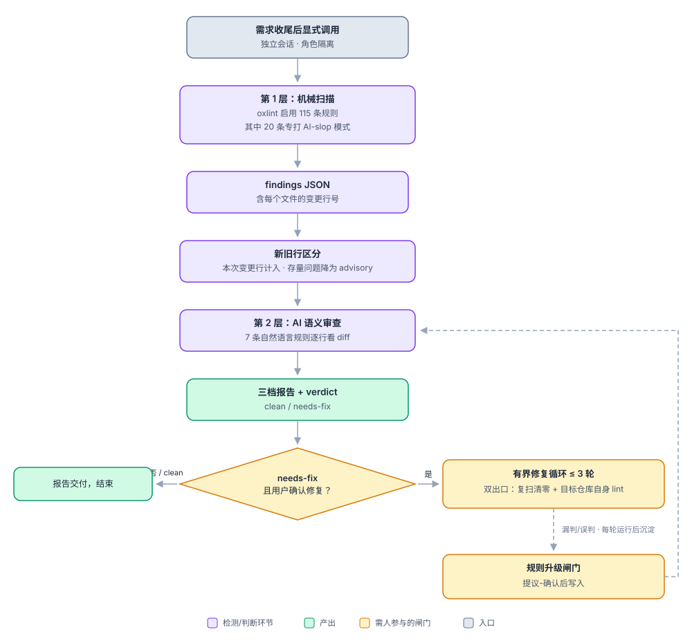

# 对抗 AI 加速的架构熵增：slop-linter 双层检测设计

> 作者：Jun Yang · 2026-10-13 · 姊妹篇：[AI 时代的架构熵治理：熵增为什么加速，以及六道防线](https://visable.atlassian.net/wiki/spaces/~71202075c2285d8115445a8b9dc5244bebf36f/pages/722305072)

## 背景：AI slop 是熵增的最小单位，现有门禁拦不住它

**架构熵**——理解和修改系统的成本随时间自发增长——在 AI 时代从"按行计息"变成了"按秒计息"：AI 把代码生产成本压到接近零，而理解成本一分没降。熵增最隐蔽的来源不是某次大错误，而是 **AI slop（AI 代码垃圾）**：AI 编码助手系统性产出的低质量模式。这些代码能跑、测试能过，但每一处都是没人要求的偶然复杂度：

| 模式 | 例子 |
|---|---|
| 复述式注释 | `// 调用 fetch 接口获取数据`、"for issue#123"、多段 docstring |
| 防御性兜底 | 给不可能失败的内部调用包 try/catch、加无意义的 null 检查 |
| 过早抽象 | 只有一个实现的接口、预防性泛化、"以后可能用到"的参数 |
| 无需求兼容层 | backward shim、没人要求开关的 feature flag、"// removed" 尸体注释 |
| AI 腔与膨胀 | emoji、data1/tmp2/handler2 式命名、与实现不符的注释 |

它贵在三点：

- **没有欠条。** 传统技术债至少知道坑在哪（"这里偷懒用了全表扫描"），slop 以"合法代码"形态入库、混进"没人敢碰的代码"，是"未审查合并"这种按秒计息新债的主体。
- **绕过所有现有门禁。** ESLint/Prettier 查"语法与风格对不对"，E2E 验收查"功能通不通"，Code Review 查"设计合不合理"——上面每一种模式单看都是"合法代码"。而人工评审正被 5 倍生成速度击穿成盖章，大 diff 的"第一个完整读者可能不存在"。
- **喂大债务飞轮。** 看不懂的代码 → 评审被放弃 → 更多 slop 入库 → 更看不懂。打破飞轮的位置不在"要求人更认真"，而在为"人读不动"的地方补上系统性的对抗力量。

过去一年我在 AI 结对开发中的纠错偏好散落在对话记忆里，没有变成可执行的检查。slop-linter 把它们变成**需求收尾后可显式调用的检测环节**——它是架构熵治理六道防线中"规则要硬"与"验收证据化"两条防线在代码质量维度上的落地。

## 方案：确定性 + 语义双层检测

五个关键设计决策，每个都对准一种熵增机制：

**1. 双层检测，各管一段——对齐"能判定的绝不留在共识层面"。** 机械层是确定性规则引擎（同一输入永远同一输出），负责可以精确匹配的模式，如 emoji、链式类型断言；语义层是 AI 按自然语言规则逐行审查 diff，负责需要"理解意图"的模式，如"这段防御代码针对的场景根本不可能发生"。单靠任何一层都会漏：纯机械规则写不出"注释是否复述了代码"，纯 AI 判断又不可复现、易漂移。判定依据持续从语义层"毕业"为机械层规则——检查的硬度随使用不断增加。

**2. 目标仓库零侵入——对齐"治理本身也是成本"。** 不装依赖、不改配置、不提交任何文件，对目标仓库只读；唯一写操作是修复循环，且必须用户逐次确认。检测工具对被检对象保持"客座"姿态，检查本身不制造新的偶然复杂度，才可能推广到任何仓库。

**3. 只对本次变更计分——对齐"熵增量与存量分开"。** 引擎输出每个文件的变更行号，落在本次新增/修改行的问题计入 verdict（结论），存量代码的历史问题降为 advisory（仅列出、注明非本次引入）。治理对象是**本次变更新增的熵**，目标是"每次变更不熵增"；存量债另走还债迭代，不混进同一个闸门——否则第一次扫老仓库就会被历史债淹没。

**4. 修复有界，出口双查——对齐"减法必须由人显式发起"。** 检出问题后可进入自动修复循环，但最多 3 轮；修不完的升级人工。出口必须同时满足两个条件：复扫问题清零 + 目标仓库自己的 lint 通过——防止"修了 A 坏了 B"。修复不自动 commit，slop 清理单独成 commit：删什么、合什么，发起权与审查权始终在人。

**5. 判定依据可治理、可演进——对齐"同一个错误第二次进系统，就应该写进系统"。** 语义规则集中在一个规则文件，漏判/误判经"提议-确认"闸门回写并单独成 commit（git 历史即规则升级日志）；误报多则降级，多人协作的隔离结构（ID 命名空间、版本锚点）已预埋。规则库是活的对抗力量，而不是又一份会漂移的文档。

### 与六道防线的对应关系

| slop-linter 机制 | 对应防线 | 对抗的熵增环节 |
|---|---|---|
| 机械层确定性规则（115 条启用，20 条 slop 专项） | 防线 1「规则要硬」 | 一致性崩坏：十人十种生成风格 |
| 语义层 AI 审查 + 三档报告 + verdict | 防线 4「验收证据化」 | 评审被击穿成盖章；"未审查合并"的按秒计息新债 |
| 新旧行区分（变更行计分、存量降 advisory） | 防线 6「度量闭环」 | 熵增量与存量债混同，治理无从下手 |
| 修复循环（人确认、≤3 轮、双出口、不自动 commit） | 防线 5「人做减法」 | AI 只做加法、从不做减法 |
| lessons 回写（提议-确认闸门） | 防线 2「规范到场」 | 同一个错误第二次进系统 |
| 语义规则毕业为机械规则 | 防线 1 × 防线 4 配合 | 减下来的成果不被规则锁住，下轮 AI 又长回来 |
