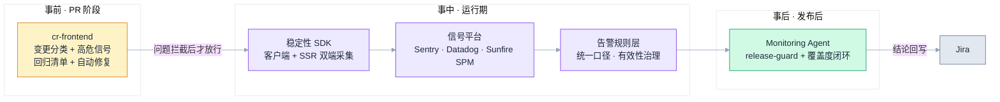
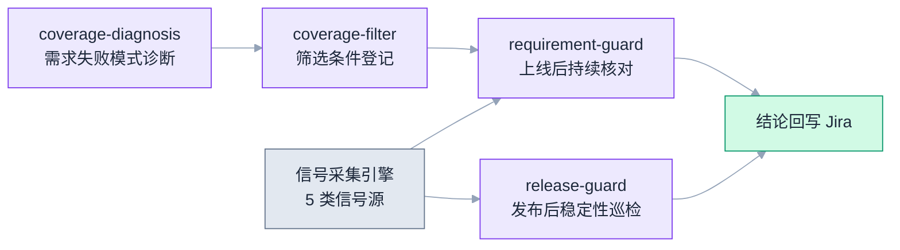

# 前端稳定性的系统性架构：稳定性 SDK × AI CR × Monitoring Agent

> 数据口径 2026-03-30 ~ 2026-09-30 · 面向研发读者

## 导语：稳定性是架构问题，不是勤奋问题

先看一个真实案例：business-insights 生产环境的容器每 22 小时死一次，持续五天，错误日志一条都没有，内存爬到 99.78%——它被抓住，是因为内存告警在响；它被定位到根因，靠的是日志交叉验证、九轮压测复现和三方版本对照。**这个案例从头到尾没有用到任何单点工具的运气，用到的每一环都是体系里预先建好的能力。**

过去做稳定性，常见姿势是"出事 → 加告警 → 下次早点知道"。这个姿势的天花板很明显：告警铺得再满，问题在 PR 阶段没拦住、数据链路不同源、发布之后没人看，桶照样漏水。我们的答案是把它当架构问题来做——**一套覆盖"编码 → 发布 → 运行 → 需求闭环"全生命周期的防线**，由三个核心组件和一个数据底座组合而成：

| 生命周期阶段 | 组件 | 一句话职责 |
|---|---|---|
| 事前 · PR 阶段 | cr-frontend（AI Code Review） | 把资深工程师的稳定性判断固化成规则，在每个 PR 上自动执行 |
| 事中 · 运行期 | 稳定性 SDK + 信号平台 | 客户端与 SSR 双端采集，一套数据底座喂所有监控平台 |
| 事后 · 发布后 | Monitoring Agent | 发布守护与需求级监控覆盖闭环，结论自动回写 Jira |
| 贯穿全程 | 诊断方法论 | 告警之后如何破案——第四章用真实案例完整演示 |

> 图例：黄 = 事前拦截｜紫 = 数据底座与信号层｜绿 = 事后闭环

---

## 一、数据底座：稳定性 SDK 与多平台信号链路

所有上层能力——告警、Agent 巡检、诊断分析——都站在同一份数据上。底座的设计目标只有一个：**业务信号和稳定性信号同源，别让每套监控各说各话。**

### 1.1 稳定性 SDK：双端采集

SDK 以 Nuxt 插件形态接入应用（服务端 `@visable-dev/monitoring-server` + 应用侧 monitoring 插件），业务代码零改动：

- **服务端（SSR）**：SSR 渲染过程监控、api_slow 慢请求上报（超过 3s 的请求以 fire-and-forget 方式异步上报，不阻塞渲染主链路）、Sentry server 初始化、Datadog 日志集成（dd-trace/logger 链路）。
- **客户端**：JS 错误、页面崩溃签名、用户侧性能信号。

铺设范围覆盖 Buyer 侧 4 个应用与 Supplier 侧 1 个应用，并完成一次统一版本升级收敛。

### 1.2 信号链路：一条管道喂所有平台

SDK 上报到 ODPS 明细表（`s_tt_v_web_metrics_tt4`），经聚合表（`visable_fe_full_monitoring_data_v1`）进入 Sunfire SPM，共 6 类 event_type。这条链路的价值在于**一套采集、多处消费**：业务看板和稳定性告警读同一份数据，不会出现"埋点团队说有、监控平台说没有"的口径分裂。

在此之上是四个信号平台，各管一段：

| 平台 | 职责 |
|---|---|
| Sentry | 前端异常聚合（JS 错误、崩溃） |
| Datadog | 容器资源与日志（Memory / CPU / Server Errors） |
| Sunfire SPM | 业务侧性能与错误率（经 ODPS 链路） |
| CloudWatch | 基础设施层（AWS 容器指标） |

### 1.3 告警规则层：统一口径 + 有效性治理

告警规则按统一口径建设：通用错误信号沉淀为共享监控项按项目规则拆分，项目级模板固定五条（Memory / CPU / p75 / Server Errors / Status:error），SSR 渲染错误归口专门规则、避免与容器告警重复喊人，通知收敛到一个钉钉群。规则层本身经过两轮质量治理——**该静音的静音**（三类误报源对应四个降噪 PR：已知噪音忽略列表、导航中断的 fetch 豁免、低置信慢检查默认关闭）和**该响的验证过**（把真实事件拿来复核：Sentry 单日 35 倍的错误回归、真实故障窗口持续高原式的 white_screen 读数，都确认在体系内被完整捕获）。

这一层有个可复用的检验标准：**每条告警都要能回答两个问题——"它抓到过真问题吗？"和"它冤枉过系统吗？"** 两个答案都没有的告警，等于没有。

---

## 二、事前防线：cr-frontend，把检查前移到 merge 之前

### 2.1 问题：回归靠人记，稳定性靠资深

线上稳定性问题的最小成本修复点，永远在 merge 之前。但 PR review 的现状是：回归范围靠 reviewer 个人经验记忆，SSR 安全、埋点影响、实验配置清理这些"专项"完全依赖有人想起来查。cr-frontend 要做的就是**把这份判断固化成规则库，在每个 PR 上自动执行**。它也是前端五层防线（浏览器插件 → Cypress E2E 门禁 → AI CR → QA → 24h 巡检）中的 AI CR 层。

### 2.2 工作流：从 diff 到修复

cr-frontend 以 PR diff 为输入，走一条固定流水线：

1. **变更分类**：diff 自动归类为七种类型之一或多类组合（公共组件大改、业务逻辑、纯 UI、非业务、埋点变更、实验上下线、SEO 变更）——分类决定后续回归范围。
2. **高风险信号扫描**：七类信号命中任意一条，风险等级强制升级为 High——SSR 渲染逻辑变更、SEO 核心 meta、全局路由/中间件、GA 事件 schema、第三方 SDK 版本升级、公共组件升级、跨应用/跨模块变更。
3. **回归清单生成**：变更类型映射到必测用例集合，reviewer 和 QA 拿到的是清单而不是"感觉"。
4. **专项评估**：埋点影响评估（含间接点击、DOM 结构与导航导致的漏埋）、SSR 安全调用链评估（`window`/`document` 在服务端执行路径上的暴露）、实验配置清理完整性、命中 SEO 信号时的深度 SEO 评估。
5. **规则库审查**：前端规范、性能、Vue 3 / React 框架规则（按 package.json 依赖自动加载），规则以 `.mdc` 单源维护、与编辑器实时提示共享同一套内容——**PR 上拦的和应用里写的时候提示的，是同一条规则**。
6. **自动修复**：无歧义问题直接修复后复审；有风险的修复先与开发者确认再动手。

### 2.3 项目级扩展

规则库之上还有项目层：`projects/{repo}.md` 追加各仓库特有的高危信号与回归项，通用规则 + 项目个性两层叠加，新仓库接入只需要写一份增量配置。

---

## 三、事后闭环：Monitoring Agent，从"工具"到"同事"

### 3.1 架构拆分：采集引擎与发布生命周期分离

Monitoring Agent 对应部门 FY27 OKR 中 Harness Agent 编排方向的监控侧落地，架构上拆成两层：

- **monitoring-orchestrator（信号采集引擎）**：聚合 Datadog、Sentry、稳定性 SDK 等 5 类信号源，一次调用拿到任意时间窗口的全景信号，并保持与上游平台的契约稳定——平台 API 怎么变，上层无感。
- **release-guard（发布守护）**：负责发布的生命周期——发布识别与标记、巡检调度、告警门控、结论回写 Jira。采集配置与判定阈值分离管理（`monitoring_config.yaml` / `thresholds.yaml`），证据统一落在 `artifacts/monitoring/<run_id>/` 供上层消费。

底层数据有一条专门的服务端稳定性查询链：`fe-stability-query → dataworks-dev-assistant → fe-stability-metrics`，让 Agent 直接消费 1.2 节那条 ODPS 链路的聚合结果，而不是重新拉原始数据。

### 3.2 四阶段巡检闭环

每次发布守护执行四个阶段：**基线快照 → 快速/深度巡检 → 回归判定 → 分级响应**。基线来自发布前窗口，巡检覆盖发布后窗口，两边对照得出"是否回归"的判定，再按严重程度分级响应。发布后巡检从"记得看"变成"默认做"。

### 3.3 需求级监控覆盖闭环

Agent 的另一半能力回答一个更早的问题：**这个需求的监控该建哪些、建够了没有？**

- **coverage-diagnosis（覆盖度诊断）**：输入需求的验收标准 / Feature List，推导业务失败模式清单，对照监控能力目录逐项匹配，输出四档覆盖度报告和最小修复建议——覆盖评估从"资深同学的经验"变成可复算的流程。
- **coverage-filter（筛选条件沉淀）**：诊断出的监控筛选条件登记为需求级 YAML 配置（active / retired 生命周期），下一轮巡检直接复用。
- **requirement-guard（上线后核对）**：持续核对登记条件下的实时信号，缺数据自动暴露，结论回写 Jira。

> 图例：灰 = 数据底座｜紫 = Agent 能力环节｜绿 = 闭环出口（人只看结论）

### 3.4 设计理念与现状

做这套 Agent 时反复问一个问题：**"这一步必须是人吗？"** 数据采集不是，跨平台信号比对不是，"发布后看一眼监控"更不是。人该做的是看结论、做决策——工具等人来用，同事把活干完来找你签字。

现状：这套体系跑通了 1 个真实需求的完整闭环，诊断到持续核对的链路已验证可行；距离"每个需求默认走这套流程"还有距离，MVP 阶段"≥5 次真实发布巡检 + 自动 Jira"的目标尚未达成，是下一阶段主线。

---

## 四、综合验证：一次生产环境内存泄漏的完整破案

这一章是前文架构的实战检验：案例本身出自依赖组合而非业务代码，cr-frontend 在这里帮不上忙——但它完整动用了**数据底座**（内存告警、日志链路）和**诊断方法论**，证明了架构兜底的价值。案例发生在 business-insights-frontend。

### 4.1 现象：一条会"锯齿"的内存曲线

CloudWatch 的 `MemoryUtilization`（容器工作集口径，非 Node 堆）一周内从低位爬到 **99.78%**，伴随周期性陡降——曲线呈锯齿状。陡降通常有两个解释：发布重置，或 OOM（内存耗尽被系统杀掉）重启。第一个问题：到底是哪个？

### 4.2 排查：三组关键证据

**证据一：版本全程不变。** 拉取 09-08 → 09-12 生产环境记录：5 天 **10 次容器重启**，版本号全部是 287，**零发布**——"发版引发"的假设被排除。

**证据二：死亡是静默的。** 交叉核对 Datadog 日志：两个 task 死亡全程**零错误日志**，没有 V8 FATAL ERROR 这类崩溃输出。进程是被 SIGKILL 静默处决的——这是**内核 cgroup OOM** 的签名，而非应用自己崩溃。

**证据三：外部完全不可观测。** 复盘存活期内的延迟曲线：p50 全程平稳，直到坍塌前没有任何劣化征兆，唯一的先兆是坍塌前一两分钟零星出现 1~3 个/分钟的 502。也就是说，**这个故障从用户视角几乎不可见，只有内存监控能抓住它**——反过来证明了数据底座里 Memory 这一条的价值。

三组证据拼出的画像：一个安静的、每天准时发生的 OOM。

### 4.3 压测复现：把"每天死一次"搬进 staging

自研零依赖压测脚本，先后跑了九轮，逐步逼近真相：

| 轮次特征 | 关键发现 |
|---|---|
| 恒定 20 并发 | task 死于 ~343/344/349 个成功请求——死亡点第一次收敛 |
| 并发 1→20 线性爬坡 | 1~3 并发的温和流量下照样死在 ~362——**死亡与速率、并发完全无关** |
| 1 rps 恒定 10 分钟 | 353 个请求后准时死亡——prod 每日一死的压缩版 |

结论收敛成一句话：**泄漏按累计请求数积累，与流量速率无关**。死亡阈值 ~350 req/次，全天 10 个 task 的死亡点全部落在 343~362 区间。用 prod 的日常流量反推（约 0.1~0.3 请求/分钟）：攒满 350 个请求需要 19~58 小时——与观测到的"每 task 存活 ~22h"严丝合缝，生产环境"每天死一次"的模型彻底自洽。

顺带摸清了容量底牌：该应用单 task 的有效 SSR 吞吐天花板约 4~6 rps，超过它就进入死亡螺旋——这个数字后来直接用于压测安全边界的设定。

### 4.4 三方对照：破案的决定性一步

泄漏只被量化还不够，要回答"谁泄的"。把三个同框架应用摆上解剖台做差分：

| 因子 | BI（漏） | supplier-onboarding（不漏） | product-editor（不漏） |
|---|---|---|---|
| monitoring SDK | ✅ 08-28 接入 | ❌ 未接入 | ✅ 2025-12-17 起 |
| Nuxt | 3.19.2 | 3.17.3 | **4.4.4** |
| Vue | 3.5.21 | 3.5.13 | **3.5.34** |

product-editor 是决定性证据：它 2025-12-17 接入同一个 monitoring SDK 后出现过**一模一样的病**（Nuxt 3.x + Vue 3.5.2x），2026-05-08 通过升级 Nuxt 4.4.4 根治（连带 Vue 3.5.34，只改了 package.json 和 lockfile），此后 **4 个月零复发**。

中途还排除了一条歧路：把 Vue pin 到 3.5.42 再压测，死亡阈值从 ~350 提升到 ~1015——**只减速 3 倍，没有治愈**；随后验证 3.5.33 同样如此。单改 Vue 版本无解，主战场锁定在 Nuxt 3.x SSR 层。

源码层面同步排查：通读 monitoring-server SDK 后没有发现显式的无界数据结构，最可疑的是 api_slow 上报采用 fire-and-forget POST 且无超时控制——泄漏场景下 undici 请求队列持续堆积是候选机制；SDK 在 Nuxt 插件内**每请求**初始化 Datadog logger（对比其他应用的 --require 模块单例模式）被判定为加重因素而非触发器。

### 4.5 根因模型与修复路径

统一模型：**泄漏 = monitoring SDK（每请求实例化应用）× Nuxt 3.x SSR 层 × Vue 3.5.2x 三者的交互**。三个因子单独看都无害，凑齐才发作——这解释了为什么 BI 无 SDK 时跑了一年不漏、supplier-onboarding 没接 SDK 一直干净、product-editor 升级 Nuxt 后四个月干净。

修复路径两条：**正解 = 升级 Nuxt 4.4.4**（product-editor 已验证的同款处方）；**止血 = 回滚 287 版本摘除 SDK**。

### 4.6 破案方法论复盘

1. **曲线对齐**：内存陡降时刻与 503 故障窗口逐点吻合——两份独立数据互为证词。
2. **日志反证**："没有错误日志"本身就是证据——它把嫌疑从应用崩溃改判为内核处决。
3. **版本对照**：版本号全程不变，一行配置排除一大类假设。
4. **量化复现**：不在 staging 猜，在 staging 测——九轮压测把"大概会漏"变成"350 个请求必死"。
5. **三方差分**：单个应用只能证明"有病"，三个应用的因子矩阵才能证明"哪味药"。

---

## 五、收束：组合起来的系统性能力

### 5.1 四个组件，一个闭环

回到架构图：**cr-frontend 拦在 merge 之前，稳定性 SDK 和信号平台在运行期产数据，Monitoring Agent 在发布后跑闭环，诊断方法论在故障发生时兜底**。四个能力不是四个孤岛——它们共享同一条数据链路（ODPS 链路）、同一套规则语言（.mdc 规则库）、同一个协作出口（Jira）。数据从 SDK 流向告警和 Agent，问题的修复结论从 cr-frontend 和 Jira 流回去，形成完整的循环。

### 5.2 三条架构原则

1. **稳定性左移**——把检查放进 merge 之前，比线上修便宜两个数量级。
2. **数据同源**——一套采集底座喂所有信号平台，别让每套监控各说各话。
3. **闭环自动化**——人的判断留在结论处，机械环节全部交给系统。

### 5.3 边界与下一步

同样重要的是没做完的事：Agent 覆盖度闭环目前跑通 1 个需求，离"每个需求默认覆盖"还有距离；BI 内存泄漏根因锁定，修复落地仍在推进；告警规则层的线上生效状态需要持续对账——防线建起来只是开始，持续运营才是常态。

如果这套架构对其他团队有用，第一步不是建系统，而是**画出你们自己的全生命周期防线图**：编码、发布、运行、需求闭环，每一段写下"现在靠谁"。哪一段写的是具体某个人的名字，哪一段就是你的架构缺口。
